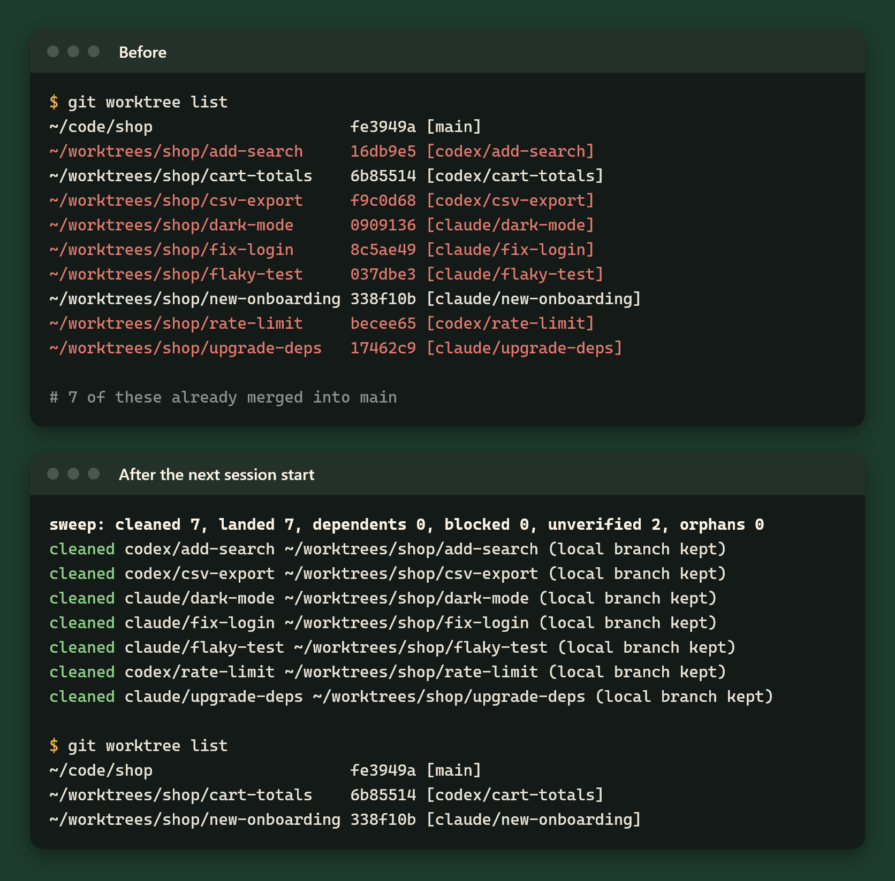
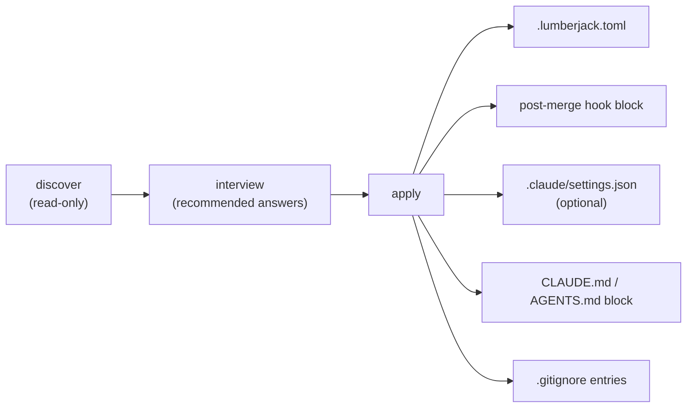

<p align="center"></p>

# lumberjack

[](https://github.com/VforVal/lumberjack/actions/workflows/test.yml)
[](LICENSE)
[](CHANGELOG.md)

**Ten worktrees, and seven of them merged last week.** lumberjack removes worktrees once
their work has verifiably landed on the primary branch, and keeps the branch. A Stop hook
blocks an agent from ending its turn while the branch name or the primary checkout is wrong.
It ships as a plugin for Claude Code and Codex.



## Quickstart

1. Install the plugin (Codex: see [Install on Codex](#install-on-codex)):
   ```
   /plugin marketplace add VforVal/lumberjack
   /plugin install lumberjack@lumberjack
   ```
2. In the repository, run `/lumberjack:setup` (Codex: pick `lumberjack:setup` from the
   skill picker) and answer its questions.
3. Review `git diff` and commit. Done: the next session start sweeps, and the Stop gate is on.

Setup reads the repository, asks, then writes; it never commits:



The rest of this page is reference: requirements, install details, configuration, the
cleanup rule, detection tiers, the summary line, hook placement and uninstall.

## Requirements

- `git`
- [Python 3.11+](https://www.python.org/downloads/) on PATH as `python` or `python3`.
  The scripts use only the standard library; no `uv`, virtual environment or runtime
  packages are needed. Every hook tries `python3`, then `python`, and runs the first that
  reports 3.11 or newer. When neither does, the post-merge hook skips and the plugin
  hooks run `python3` anyway, so its error shows in the harness: `not found`, or
  `lumberjack: Python 3.11+ required, found <version>` from an older Python.
- Optional: `gh`, logged in, to detect squash-merged and rebase-merged pull requests.
  Without it the sweep decides from git alone and fewer branches count as landed.

## Install on Claude Code

The two `/plugin` commands in the [Quickstart](#quickstart) install from the marketplace.
Setup (below) can also write `.claude/settings.json` so teammates are prompted to install
the plugin when they open the repository; you commit that file yourself.
Try a checkout without installing: `claude --plugin-dir <path-to-checkout>`.
Setup also prints the equivalent shell commands, `claude plugin marketplace add VforVal/lumberjack`
and `claude plugin install lumberjack@lumberjack` (tested with Claude Code 2.1.299).

## Install on Codex

Setup prints these three lines for you to run. Marketplace registration and installation
were tested with Codex CLI 0.162.1 in an isolated configuration directory:

```
codex plugin marketplace add VforVal/lumberjack
codex plugin add lumberjack@lumberjack
then run /hooks once in Codex to trust the plugin hooks
```

Restart the harness after installation. Review and trust the installed hook commands
before enabling them. If your version rejects a command, check `codex plugin --help`
or `claude plugin --help` and upgrade to a tested version before continuing.

## Setup

In Claude Code, run `/lumberjack:setup` once per repository. In Codex, choose
`lumberjack:setup` from the skill picker. The agent reads facts about the repository
(`discover`, read-only), then asks about harnesses, branch shape, worktree roots,
cleanup and Stop gate behaviour, the git hook and an evidence directory and doc roots, each with a
recommended answer. Doc roots are suggested from a `.scratch/` folder and ignored top-level
folders that hold Markdown (found by file name, without reading any file), each with a reason;
a re-run keeps your saved `doc_roots`. After your yes it writes `.lumberjack.toml`, the post-merge hook,
the `CLAUDE.md` (else `AGENTS.md`) block (creating `AGENTS.md` when neither exists),
optional `.claude/settings.json` pinning and
`.gitignore` lines for worktree roots inside the repository. It never commits; review
`git diff` and commit it yourself. Re-running is safe.

If git or Python 3.11+ is missing, install the requirement before setup. The PATH that
matters is the one the harness and Git hooks inherit; an interactive shell alias is not
enough. After upgrading from a uv-based release, re-run setup to refresh the post-merge hook.
For authentication errors, run `claude auth login` or `codex login` before invoking the setup skill;
`gh auth login` enables pull-request landing evidence. Installation alone does not
prove that the setup skill or hooks ran.

## Configuration

Optional `.lumberjack.toml` at the repo root (top-level keys), else a
`[tool.lumberjack]` table in `pyproject.toml`; the first file found is used.
Missing keys keep these defaults. A config error (unknown key, bad TOML, a `cleanup`
outside the three modes, a non-boolean `stop_gate`, a key of the wrong TOML type, an empty
`prototype_prefix`) makes the Stop gate block;
SessionStart prints the error and cleans nothing.

| Key | Default | Meaning |
| --- | --- | --- |
| `owners` | `[]` | Allowed branch prefixes `<owner>/...`; empty accepts any lowercase owner |
| `ticket_prefix` | `""` | Issue slug prefix in branches and directories; empty makes the ticket segment optional |
| `prototype_prefix` | `"prototype/"` | Prototype capture branch prefix; such branches are never cleaned |
| `primary_branch` | `"main"` | Branch the primary checkout stays on and work lands in |
| `evidence_dir` | `""` | Directory inside a worktree whose contents block cleanup; empty protects nothing extra |
| `doc_roots` | `[]` | Folders inside a worktree for work documents (handoffs, plans, research, run output); an untracked or ignored file under one blocks cleanup with `docs`. `evidence_dir` is one more such folder but keeps its own reason, `evidence` |
| `doc_reference` | `{}` | Per doc root, the words that make a bundle `reference` instead of `ephemeral` when its folder name contains one (case-insensitive); a root not listed uses `["research", "prototype"]`. A table: `[doc_reference]` then `"docs/work" = ["spike"]` |
| `doc_strategy` | `{}` | How `/lumberjack:cleanup` trashes doc bundles, saved after it asks once (empty: nothing is removed). Keys, both required once set: `scope` (`markdown` or `bundle`) and `trash_days` (whole days, at least 1); optional `roots`, a table of doc root to `keep` whose bundles are always kept, so `roots = {"docs/handoffs" = "keep"}` keeps every handoff. The old keys `ephemeral`, `reference` and `tracker` are a config error. A table: `[doc_strategy]` then `scope = "bundle"` |
| `worktree_roots` | `["~/.codex/worktrees/*", ".claude/worktrees", "~/worktrees/{name}"]` | Where worktrees live: `~` is home, `*` a glob, `{name}` the repo name |
| `cleanup` | `"prune"` | `prune` removes landed worktrees; `report` lists them as `would remove`; `keep` does nothing |
| `stop_gate` | `true` | `false` turns the Stop hook off |

```toml
owners = ["alice", "codex", "claude"]
ticket_prefix = "eng-"
primary_branch = "trunk"
evidence_dir = ".evidence"
doc_roots = ["docs/work"]
```

## Cleanup rule

After fetching `origin` (5 second limit; on failure the summary says `origin stale`),
a worktree is removed only when its tip is verified landed in `origin/<primary_branch>`
and nothing blocks it. Eight reasons block it, and the sweep names the one it hit:

- `current checkout`: the sweep is running inside this worktree
- `locked`: the worktree is locked with `git worktree lock`
- `dirty`: uncommitted or untracked files (ignored files do not count)
- `unpushed`: no upstream, or the tip is not contained in it; waived when a merged pull
  request had exactly this tip
- `evidence`: `evidence_dir` is set and not empty in the worktree
- `docs`: a `doc_roots` folder holds a file that git does not track, ignored files included
- `tip diverged`: a pull request from this branch merged into the primary branch with a
  different tip
- `fresh`: the worktree was added less than 24 hours ago and its branch has not moved since
  it was created (its reflog has only the creation entry, or no entry at all). A new branch
  from `origin/<primary_branch>` looks landed and pushed, but its session may have just started

If git itself refuses the removal, git's message is the reason. Removal deletes no commits:
the branch is kept. Bring the work back with `git worktree add <path> <branch>`.
Uncommitted files are not recoverable, which is why `dirty` blocks.

The whole cleanup is skipped, with one line and exit 0, when the primary checkout is not
on `primary_branch` (`sweep: primary checkout is not on <primary_branch>; skipped`),
when `origin/<primary_branch>` is absent (`sweep: origin/<primary_branch> is missing; skipped`),
or when the post-merge hook fires in a worktree other than the primary
(`sweep: not the primary checkout; skipped`). A landed branch without a worktree is
counted as `landed` and still gets `dependent` lines; nothing is deleted for it.

## Detection tiers and reasons

Each tip is checked against `origin/<primary_branch>`; the first decisive tier wins.

| Tier | Meaning | Removable |
| --- | --- | --- |
| `integrated` | tip is an ancestor of the primary branch | yes |
| `content-integrated` | merging the tip changes nothing in the primary branch's tree | yes |
| `landed-pr` | `gh` found a merged pull request into the primary branch with this exact tip | yes |
| `landed-probable` | patches match recent primary history; a guess | only when confirmed in `/lumberjack:cleanup` |
| `unverified` | no evidence of landing | only when confirmed in `/lumberjack:cleanup` |

An `unverified` row carries a reason: `gh missing`, `not a github remote`,
`unauthenticated`, `unreachable`, `tip diverged`, `non-primary base`
(merged, but into another branch) or `no pull request`, with `; origin stale` appended
when the fetch failed. Only the first 100 branches go to `gh` in one query; the rest get
`no pull request`. Plain `sweep_worktrees.py` output and `--json` show tier and reason.

## Summary line

Plain `--cleanup` prints one summary line, then one line per event (`cleaned`, `landed`,
`blocked`, `dependent`, `orphan`, `doc`, `hint`), and exits 0. When the cleanup was skipped
(see above) or the config is invalid, the only line says why instead:

```
sweep: cleaned 1, landed 2, dependents 1, blocked 1, unverified 3, orphans 0, docs 1, origin stale
cleaned alice/eng-12-login ~/worktrees/app (local branch kept)
blocked alice/eng-13-search ~/worktrees/app2: dirty
doc ephemeral docs/work/eng-9-handoff: tickets eng-9, eng-11; 3.2 MB
dependent alice/eng-14-ui of alice/eng-12-login: git rebase --onto main 0123456789ab alice/eng-14-ui
trash 20260101T120000Z: 41 days old; 3.2 MB
```

A `dependent` line is a branch built on top of a landed one; run the printed rebase
before pushing it. A `trash` line is a folder in lumberjack's trash older than `trash_days`;
the summary gains `, trash N` (before `origin stale`) only when there are such folders. The sweep
never deletes them; only `--purge-trash` does.
A `doc` line is a bundle: the outermost untracked entry (file or folder) under a `doc_roots`
folder, below tracked subfolders too, in the primary checkout; tracked files and registered
worktrees (or folders holding them) are never listed. Its tickets are the
`ticket_prefix` ids in its folder name plus those on a `Ticket:` or `Tickets:` line in the head
of its top file (the first Markdown file, else the first file); without a `ticket_prefix` no
ticket is found. The class is `reference` when the name holds `research` or `prototype`
(`doc_reference` changes the words per root), else `ephemeral`. A bundle is `live` when a
worktree's branch or folder name, or an unlanded local branch, carries one of its tickets
(so a Codex worktree on a detached HEAD counts), or when its path (or its folder name, when that
carries a ticket) appears in a tracked file or in a commit message of an unlanded branch
(only commits not yet in `origin/<primary_branch>`,
the newest 1000), so a bundle that lists a ticket whose branch has landed stays live while
another listed ticket is open; `linked` when it has tickets and none is live, `unlinked` without
tickets and not named. `docs N` and the lines cover linked bundles only (`--json` lists
all three states under `docs`); the size comes from file metadata, never file contents, and
reads `size unknown` if sizing runs past 10 seconds. Nothing is deleted. Orphans are leftover directories in a worktree root: those holding
only caches (`node_modules-only`) are deleted, others (`mixed`, `not-git`; an empty directory counts as `not-git`) are listed.
A root outside the repository without `{name}` is shared with other repositories, so only
its `<dir>/<name>` subdirectories count (the Codex layout); scope your own roots with `{name}`,
such as `~/worktrees/{name}-*`.
The sweep also sets `git config lumberjack.script` so the hook finds it. A script that
runs from a linked worktree of the swept repository (as when developing lumberjack
itself) records the primary checkout's copy instead, so cleanup cannot delete it;
installed plugin paths are recorded as they are. The sweep sets `core.hooksPath .githooks`
only when `.githooks/post-merge` holds the
`# >>> lumberjack` marker and `core.hooksPath` is unset.
When a hook manager is present and its config does not mention `lumberjack.script` yet,
the last line is `hint: post-merge hook managed by <manager>; run /lumberjack:setup to add lumberjack`.

Every plugin hook runs `--hook`, which reads the harness's hook input on stdin and acts
on its `hook_event_name`. SessionStart fires on startup, resume, clear and
compaction; it runs the cleanup and delivers that report, the active configuration and the canonical
`skills/lumberjack/SKILL.md` rules through `hookSpecificOutput.additionalContext`.
The post-merge hook keeps using plain `--cleanup`.

SubagentStart refreshes rules and active settings for fresh Claude children and every
Codex child without running cleanup. Claude forks skip this refresh because they
inherit the parent context. Codex does not identify full-history inheritance in its
child-start payload, so inherited Codex children receive repeated rules as well.

On Stop, `--hook` runs the gate: debt produces an exit-0 JSON block decision
and reason, supported by both harnesses. This preserves blocking when PowerShell maps
a native exit 2 to process exit 1. Running plain `--gate` still exits 2 with its reason
on stderr. Both forms stay silent when the gate passes, is disabled, or already ran.

## Cleanup command

`/lumberjack:cleanup` (Codex: `lumberjack:cleanup` from the skill picker) clears old
worktrees in the repository it runs in. It runs `--cleanup` and `git worktree prune`
and relays their lines, then lists every `unverified` and `landed-probable` worktree with
its tier and reason, and asks about each one. It removes only the worktrees the maintainer
confirms, one at a time, with:

```
sweep_worktrees.py --remove <path>
```

`--remove` acts on that one worktree and nothing else, whatever its tier or the `cleanup`
setting, and keeps its branch. It prints one line and exits 0 when removed, 1 when blocked:

```
cleaned alice/eng-15-spike ~/worktrees/app3 (local branch kept)
blocked alice/eng-16-draft ~/worktrees/app4: dirty
```

A detached worktree's line is `cleaned (detached) <path>`, with no branch note. When
`git worktree remove` fails after it already dropped the worktree (on Windows, a locked
directory), the note adds `directory left`, as in `(local branch kept; directory left)`,
and the exit is 0; delete the leftover directory by hand. A failure that leaves the
worktree registered prints `blocked` with git's error.

It refuses with `current checkout`, `locked`, `fresh`, `dirty`, `evidence` or `docs` as in
the cleanup rule (an unpushed tip is no loss, since the branch keeps it), and also with:

- `ignored files`: ignored files other than caches (`node_modules`, `.venv`,
  `__pycache__`, tool caches), which removal would delete
- `prototype`: a `prototype_prefix` branch, which is never cleaned
- `primary checkout`: the path is the primary checkout
- `no branch`: a detached tip that no local branch contains
- `not a worktree`: no registered worktree at that path; the line is
  `blocked <path>: not a worktree`

On a `dirty` or `ignored files` block, the command lists the stray files, groups them by
what produced them and asks once per group: delete, ignore (`.git/info/exclude` or
`.gitignore`) or commit and push. It never asks file by file. The same rule is in the
`lumberjack` skill for a `blocked ...: dirty` line at session start.

### Work documents

When `doc_roots` holds linked bundles, `/lumberjack:cleanup` asks the maintainer once for a
`doc_strategy` (scope, trash days, keep-roots) and saves it with
`setup_lumberjack.py strategy <file.json>`; later runs ask nothing, and until it is saved
nothing is removed. A linked bundle's work is done by git alone: no tracker is checked. The
command offers linked bundles one question per group. `ephemeral` bundles are trashed; a bundle
under a `roots` keep-root is kept (never offered). Nothing deletes a bundle outright: `--clear`
only moves it to the trash. `--json` gives each doc its resolved `action` (`trash`, `promote` or
`keep`), empty until a strategy is saved.
`reference` bundles are only offered promote or keep: promote writes the findings to a document
tracked on `origin/<primary_branch>` or pushes a `prototype_prefix` branch, and only then clears the
bundle, always into the trash. `scope = "markdown"` acts on `.md` files only, `"bundle"` on the whole entry,
run output included. The script does the removal:

```
sweep_worktrees.py --clear <bundle path>... [--promoted <doc path or prototype branch>]
sweep_worktrees.py --purge-trash
```

`--clear` prints one line per path and exits 0 when all are done, 1 when any is blocked.
With `--promoted` it fetches `origin` first (5 second limit), so a just-merged promotion counts:

```
cleared docs/work/eng-9-handoff: trashed 20260101T120000Z
blocked docs/work/eng-9-handoff: kept by strategy
```

Reasons: `no strategy saved`, `not a bundle`, `live`, `unlinked` (only a `linked` bundle is
cleared), `links outside the repository` (the bundle, or with `scope = "markdown"` any entry in it, resolves outside the repository through a symbolic link or Windows junction; a link inside a bundle cleared whole moves to the trash as a link, not followed), `kept by strategy`
(its doc root is a keep-root), `no Markdown in scope` (`scope = "markdown"` and the bundle holds no `.md` file), `promote it first (--promoted)` and `the promoted copy is not on
origin`. A trashed bundle moves to `<git dir>/lumberjack-trash/<UTC timestamp>/<its path>`, which
git never sees. `--purge-trash` deletes the timestamp folders older than `trash_days`, printing
`purged <timestamp>` for each, or `trash: nothing past retention`.

## Hook placement

Setup installs a post-merge hook that runs the sweep after every merge. It skips silently
when no `python3` or `python` reports 3.11+, or `git config lumberjack.script` or the
configured script file is missing.
Everything setup adds sits
between `# >>> lumberjack` and `# <<< lumberjack` lines.

| Manager | What setup writes |
| --- | --- |
| plain | `.githooks/post-merge` and `git config core.hooksPath .githooks` (printed as `ran git config core.hooksPath .githooks`); with `core.hooksPath` already set, that directory is used as is, even outside the repository |
| existing hook | the block is added to the existing `post-merge` (in `core.hooksPath`, else `.git/hooks`; a directory outside the repository, such as `~/.githooks`, is used as is); a non-shell hook is renamed to `post-merge.user` (`ran rename post-merge to post-merge.user`) and called from a new shell wrapper |
| husky | `.husky/post-merge` |
| lefthook | a `post-merge` job in `lefthook-local.yml` (lefthook merges it with `lefthook.yml`) and `note: run lefthook install to activate the hook` |
| pre-commit | a local repo entry in `.pre-commit-config.yaml` and `note: run pre-commit install --hook-type post-merge to activate the hook` |
| simple-git-hooks | the `post-merge` entry under `simple-git-hooks` in `package.json` and `note: run npx simple-git-hooks to activate the hook` |

Every file setup writes is reported as `wrote <path>`, and every installed hook is
followed by `ran git config lumberjack.script <path>`. Other lines setup can print:
`printed, not run: <command>` for each selected harness's install step,
`setup: git missing: install git from https://git-scm.com/downloads and re-run`,
`gh missing or unauthenticated: landed detection is offline-only until gh auth login`.

## Windows

The post-merge hook is a `sh` script and runs under Git for Windows; there is no shim.
The plugin hooks run the sweep through a `git` alias, so git's own `sh` picks the Python
and the command line parses the same under Git Bash and PowerShell. The Microsoft Store
`python` and `python3` aliases fail the version probe and are skipped; without a real
Python 3.11+ install the plugin hooks then print the Store message instead of running
the sweep, so install Python 3.11+ or turn the aliases off.
In the plugin's hooks, `${CLAUDE_PLUGIN_ROOT}` expands to the plugin directory.

## Uninstall

1. Remove the plugin from the harness.
2. Delete `.lumberjack.toml`.
3. Remove the marker blocks: `# >>> lumberjack` to `# <<< lumberjack` from the hook
   (delete the file if nothing else is in it; move `post-merge.user` back to `post-merge`
   if setup renamed it), and `<!-- >>> lumberjack -->` to `<!-- <<< lumberjack -->` from
   `CLAUDE.md` or `AGENTS.md`.
4. In `.claude/settings.json` remove `extraKnownMarketplaces.lumberjack` and
   `enabledPlugins["lumberjack@lumberjack"]`.
5. `git config --unset lumberjack.script`
6. `git config --unset core.hooksPath`, only if setup set it (plain hook, `.githooks`).

## Tests and CI

`python -m pip install "pytest>=8"`, then `python -m pytest -q`. CI
(`.github/workflows/test.yml`) runs pytest with plain Python 3.11 and 3.13 on Linux
and Windows; it does not install uv.

## License

[MIT](LICENSE). Terms: [GLOSSARY.md](GLOSSARY.md). Changes: [CHANGELOG.md](CHANGELOG.md).
